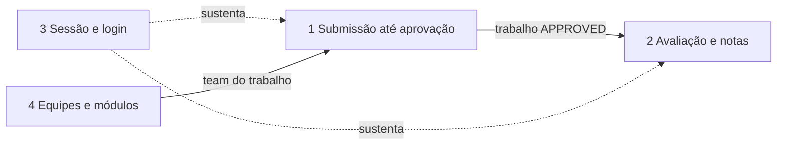

# Fluxos do Painel (índice)

Revisão do fluxo real do Painel de Integração, um fluxo por vez, cada um em
pasta própria com `flow.md` (mapa fiel ao código) e `decisions.md` (achados e
decisões). Este arquivo é o ponto de entrada: ele aponta para os demais.

Regras da revisão:
- todo passo cita `arquivo:linha` real; o que depende de config externa é `inferido`;
- nada é implementado sem decisão registrada em `decisions.md`;
- referências são relativas à pasta que contém `fabricaPainel_backEnd/` e `fabricaPainel_frontEnd/`.

## Fluxos

| # | Fluxo | Pasta | Estado |
|---|-------|-------|--------|
| 1 | Submissão até aprovação (convite, aceite do orientador, aprovação, expiração) | [submissao-ate-aprovacao](submissao-ate-aprovacao/flow.md) | revisado; A-01 a A-04 implementados, A-05 a A-09 em aberto ([decisions](submissao-ate-aprovacao/decisions.md)) |
| 2 | Avaliação e notas (banca, orientador, admin, média, relatório, lembretes) | `avaliacao-e-notas/` | pendente |
| 3 | Sessão e login (JWT, refresh, 401, permissões por tipo) | `sessao-e-login/` | pendente |
| 4 | Equipes e módulos de evento (equipe, convite de membro, staff de módulo) | `equipes-e-modulos/` | pendente |

## Como os fluxos se encadeiam

O fluxo 2 só enxerga trabalhos que saíram do fluxo 1 com status Aprovado.
O fluxo 3 é transversal: token rotacionado ou sessão caída aparece como
erro nos outros dois.
