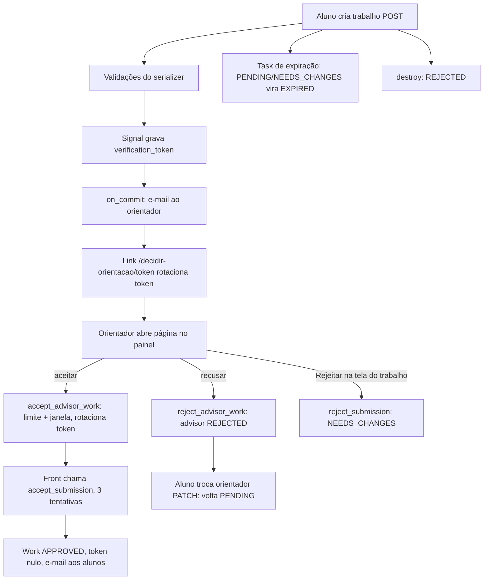

# Fluxo: Submissão até aprovação

**Escopo:** do aluno criar o trabalho até ele ficar Aprovado, Pendente com
alterações, Rejeitado ou Expirado, passando pelo convite e aceite do orientador.
**Fora do escopo:** aceite de colaborador (fluxo 4), notas (fluxo 2), login (fluxo 3).

## Diagrama

Legenda: todos os nós foram verificados no código; só o agendamento de F13
(F13a na tabela) é inferido.

## Passos

| ID | Passo | Evidência | Tipo |
|----|-------|-----------|------|
| F1 | Aluno envia o trabalho; colaboradores vêm no payload e viram `WorkCollaborator` | `fabricaPainel_backEnd/src/core/work/infra/work_django_app/views/work.py:1412-1435` | verificado |
| F2 | Valida datas de submissão, equipe, colaboradores, limites de avaliador e de orientador | `fabricaPainel_backEnd/src/core/work/infra/work_django_app/serializers.py:264-318` | verificado |
| F3 | `post_save` com `created` grava um `verification_token` e salva de novo | `fabricaPainel_backEnd/src/core/work/infra/work_django_app/signal.py:9-13` | verificado |
| F4 | Depois do commit, envia e-mails de colaboradores e do orientador | `fabricaPainel_backEnd/src/core/work/infra/work_django_app/views/work.py:1373-1391` | verificado |
| F5 | Gerar o link rotaciona o token (novo uuid salvo no Work) e monta `/decidir-orientacao/<token>` | `fabricaPainel_backEnd/src/core/__seedwork/domain/actions/work_path.py:6-19` | verificado |
| F6 | Página do painel exige login (senão manda para login com redirect) e consulta o limite | `fabricaPainel_frontEnd/src/pages/decidir-orientacao/[token].vue:14-24` | verificado |
| F7 | Aceite: confere limite de orientações e janela do orientador, marca `advisor_status` aprovado e rotaciona o token | `fabricaPainel_backEnd/src/core/work/infra/work_django_app/views/accept_advisor_work.py:50-76` | verificado |
| F8 | Front encadeia a aprovação com o token novo, com até 3 tentativas | `fabricaPainel_frontEnd/src/stores/advisorAcceptance.ts:100-126` | verificado |
| F9 | `accept_submission` exige orientador aprovado e janela, põe status Aprovado, zera token e avisa alunos | `fabricaPainel_backEnd/src/core/work/infra/work_django_app/views/submission_work.py:32-70` | verificado |
| F10 | Recusa: `advisor_status` rejeitado, novo token, e-mail aos alunos | `fabricaPainel_backEnd/src/core/work/infra/work_django_app/views/reject_advisor_work.py:23-58` | verificado |
| F11 | Trocar orientador via PATCH reabre a decisão; recusar o mesmo orientador de novo é barrado | `fabricaPainel_backEnd/src/core/work/infra/work_django_app/serializers.py:258-277` | verificado |
| F12 | `reject_submission` marca "Pendente com Alterações" e avisa alunos, sem checar janela nem `advisor_status` | `fabricaPainel_backEnd/src/core/work/infra/work_django_app/views/submission_work.py:84-106` | verificado |
| F13 | Task expira trabalhos PENDING/NEEDS_CHANGES e convites pendentes; envia PDF aos admins | `fabricaPainel_backEnd/src/core/work/domain/tasks/change_status/change_status_to_expired_works.py:21-47` | verificado |
| F13a | Agendamento: duas tarefas únicas criadas na criação da edição, nas datas finais de aceite | `fabricaPainel_backEnd/src/core/edition/domain/tasks/work_expiration_task.py:20-53` | inferido (execução depende de beat e worker em produção) |
| F14 | `destroy` não apaga: marca Rejeitado e zera tokens, mantendo histórico | `fabricaPainel_backEnd/src/core/work/infra/work_django_app/views/work.py:1503-1518` | verificado |

## Estado gravado

| Campo | Muda em | Quem lê depois |
|-------|---------|----------------|
| `Work.verification_token` | F3, F5 (a cada e-mail), F7, F10, F9 (zera), F14 | links de e-mail, tela do trabalho do orientador |
| `Work.advisor_status` | F7, F10, F11, F13 | `accept_submission`, painel, kanban |
| `Work.status` | F9, F12, F13, F14 | todo o resto (notas só em Aprovado) |
| `Work.needs_changes_submission_work_date` | F12 | tela do aluno |

## O que já está bom (manter)

- Limite de orientações conferido no aceite, onde a vaga é de fato ocupada: `fabricaPainel_backEnd/src/core/work/infra/work_django_app/views/accept_advisor_work.py:50-66`.
- Aceite e aprovação compartilham a mesma janela do orientador: `fabricaPainel_backEnd/src/core/__seedwork/domain/actions/acceptance_window.py:9-24`.
- Token do orientador só aparece para o próprio orientador na API: `fabricaPainel_backEnd/src/core/work/infra/work_django_app/serializers.py:176-183`.
- E-mails saem em `on_commit`, depois do banco confirmar: `fabricaPainel_backEnd/src/core/work/infra/work_django_app/views/work.py:1422-1432`.
- Exclusão preserva histórico em vez de apagar: `fabricaPainel_backEnd/src/core/work/infra/work_django_app/views/work.py:1503-1511`.

## Pontos não cobertos / perguntas

- Se o beat e o worker Celery estão ativos em produção e se as tarefas de F13a existem na tabela do beat (não verificável pelo código).
- A causa exata do 404 relatado pela professora ao abrir um trabalho: o código mostra mais de um jeito de um link de e-mail virar "não encontrado" (achado A-01), mas não confirma qual aconteceu.
- Aceite de colaborador e criação de equipe ficam para o fluxo 4.
